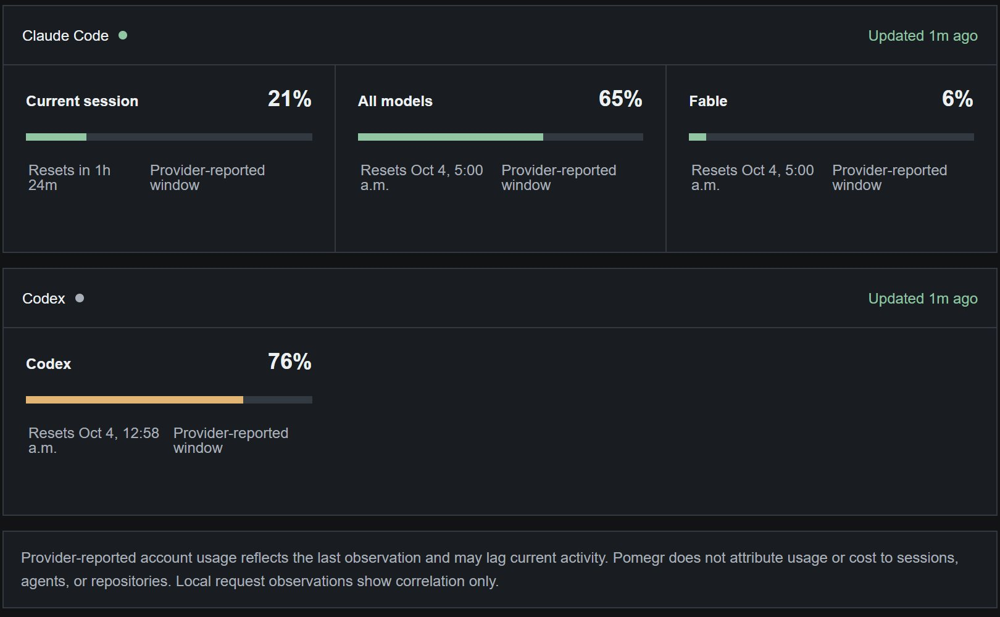

# Usage limits

**Usage limits** shows how much of each provider's account usage windows has been
used and when each window resets. The provider reports these figures for the
whole account, so they include work Pomegr never sees. Pomegr does not attribute
usage to a session, agent, or repository, does not forecast when a window will
run out, and does not show a bill.

## Read a window

Open **Usage limits** in the sidebar. Each provider has a card with one panel per
window: a label, the percentage used, a bar, the reset time, and the note
"Provider-reported window".

*A real Pomegr installation on 2026-09-30. Claude Code reports three windows
and Codex one. The Codex bar is amber because 76% is in the warning band.*

- **Claude Code:** **Current session** is a five-hour window. **All models** and
  **Fable** are seven-day windows; Fable appears when the provider reports it.
  A window with nothing used and no reset time reads **Not started**. It starts
  with your next use.
- **Codex:** one panel per window the account reports, each with its own reset
  time.

The sidebar's **Usage limits** widget repeats the highest window for each
provider that has a session created in the last seven days, such as "65% · 7
days". **View** opens the page. Percentages fall into fixed bands: 0% to 74% is
normal, 75% to 84% warning, and 85% to 100% critical. In the sidebar the figure
turns amber, then red; on the page the bar turns amber from 75%.

## How fresh a reading is

The time beside the provider name says how the reading arrived:

- **Updated** means Pomegr read the account's usage from the provider. Codex shows it.
- **Last observed** means the figures were observed by Claude Code on this computer.
  Claude always shows it. Repeated identical values keep their original time.

Pomegr checks each provider at most every five minutes, shares one check across
every open browser tab, and waits longer after a failed check. For Claude Code, the
check is a background run of your own Claude Code. It starts no model turn and has
no cost. When a check fails, the last good figures stay visible with their original
time, and the header reads **Refresh delayed**, with a retry countdown. A Claude
reading is also stale when a window has reset. A reading can lag activity elsewhere
on your account.
Historical sessions never show current limits.

## Usage notifications

The notification tray distinguishes a **window rolled over** from a window that
**has capacity again** within the same reset period. Both require a fresh usage
observation; the clock passing a displayed reset time is not confirmation.
The message names the affected window and says when another window remains
exhausted. It does not promise that the whole account can run requests. Claude
observations are labeled as local observations. The Claude body says "Observed by Claude Code on this computer."

When Codex supplies an earned-reset count, Usage limits shows that count and its
observation time. Missing or unsupported metadata shows availability as unknown.
A newly increased count can produce **Codex reset available** after an initial
baseline. Repeated counts do not generate new notifications. Availability does
not establish that a particular window is eligible: Pomegr never uses a reset.
**View usage limits** opens this page only.

**Provider updates** also includes release news. A Claude Code release shows the first
lines of its release notes as plain text. **What's new** opens the release page on
GitHub. **View providers** opens this page.

Notification comparisons need a recognized local source and complete, fresh
windows. Switching sources or encountering stale or partial evidence establishes
a new baseline. Some Codex installations, including keyring-only sources, cannot
provide that comparison evidence even when current usage is visible.

## Provider differences

| | Claude Code | Codex |
| --- | --- | --- |
| Source | A background run of your own Claude Code | The installed Codex CLI's rate-limit snapshot |
| Optional | Local usage from Claude Code's status line, as a backup | None |
| Requires | Claude Code installed with a subscription login | Native Codex CLI signed in with ChatGPT |

Claude Code's status line reports the five-hour and seven-day windows for Pro and
Max subscribers, after the first response in a session
([status-line documentation](https://code.claude.com/docs/en/statusline#rate-limit-usage),
checked September 30, 2026). It does not include the Fable window, so with local
usage, when the status line is newer, Pomegr shows the last check's Fable reading
separately as **Last reading** with its own time. The Claude check needs
`claude.exe`, so on another platform only the status-line feed is available. Codex
access with only an API key does not supply these windows.

## If a window is missing

A missing window is unavailable, not zero. If neither source has data, Claude
usage shows as not available. A failed check opens **Usage
connection help** automatically, even when older figures remain.

- **Codex CLI required for usage limits:** install or update the native Codex CLI
  on the computer running Pomegr, run `codex login` and sign in with ChatGPT, then
  fully quit and reopen Pomegr.
- **Usage unavailable (Codex):** select **Reconnect Codex** in the desktop app and confirm the browser sign-in.
  Pomegr checks usage afterward without restarting. Browser and paired-device users run `codex login` on the monitor computer.
  Completing sign-in does not confirm that usage is available.
- **Claude Code required for usage limits:** install Claude Code on the computer
  running Pomegr.
- **Usage unavailable (Claude Code):** if there is no subscription login, select
  **Reconnect Claude Code** in the desktop app, or run `claude auth login --claudeai`
  on the computer running Pomegr. After a successful sign-in, Pomegr runs the check
  once. Pomegr never reads or copies the sign-in itself.
- **No local usage:** when usage is unavailable, the installed Windows app offers
  **Enable local usage**, which asks for confirmation before it changes Claude
  Code's status-line setting. **Setup guide** opens
  [Claude Code local usage](../help/claude-local-usage.md), which also covers
  browser-only installations.
