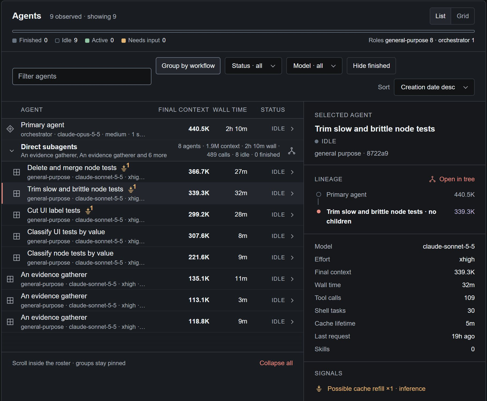

# Sessions and agents

**Sessions** lists every coding-agent session Pomegr has found, live or recorded.
Open one to see its agents. A state label describes what Pomegr could observe,
not whether the work succeeded.

## Find a session

1. Select **Sessions**. It starts on **Live** when any session is live, otherwise
   on **All**. **Needs you** narrows the list to sessions waiting for you. The
   header counts the **live** sessions, the sessions that **need you**, and the
   sessions **in all**.
2. Type in **Filter sessions** to match a session title, project, or coding tool.
   Some links open the list already filtered to one repository and add a
   **Repository** chip; select its close button to clear it.
3. Choose how the list is arranged with **Group by**. **Recent** lists the newest
   sessions first under the day they started. **Repository** and **Provider** show
   one group per repository or coding tool, with its newest sessions; select
   **Show all** in a group to list every session in it. Select a group heading
   to collapse it. **Feature** shows one group per feature, with the sessions
   Pomegr started for that feature's tasks; other sessions are not listed.
   **Show all** in a feature group adds a **Feature** chip. Pomegr remembers the
   choice in this browser. On a phone **Group by** is a menu at the end of the
   row with **All**, **Live**, and **Needs you**.
4. Read a row, then select it to open the session. A list shows 10 rows
   per page. When more sessions match, **Previous** and **Next** appear under the
   list. A day heading that goes on over a page break says **continued**.
5. Read the task of a session to see what it was started for. Its ID is on the line
   under the title, with its feature. Select the ID to open that repository's task board.
   A session you started yourself shows no task. A tag after the title appears only for
   an outcome the session cannot show: **In review**, **Stalled**, or **Done**.
   The task and its tag are shown in the desktop app and in a browser
   on the same computer, not on another device. A session started for a task also
   has a **Task** tab; see [Tasks](tasks-sessions.md#see-a-task-from-sessions).

*Real Claude Code development sessions in the Pomegr project, captured on 2026-11-03 and cropped to the page header, the filters, and two rows. The lower session was live at that moment, with 2 of its 49 agents working.*

Each row shows seven things, from left to right. On a narrow screen a row becomes a
card with the same things.

| Part of a row | What it shows |
| --- | --- |
| **Dot** | A pulsing dot means the session is live. An amber dot means it waits for you. A ring means it is not live. The [state word](#read-a-sessions-state) is the dot's text for screen readers. |
| **Title** | The session title, with the repository, the coding tool, the task, and the latest recorded activity under it. |
| **Agents** | One square for each agent, up to eight and then a `+10` for the rest, and under them words such as `1 of 3 working`. Green squares work. Grey squares do not. Hollow squares with `activity unknown` mean Pomegr does not know yet how many agents work. A session that is not live shows `3 agents` in a muted tone. |
| **Progress** | The percentage the agent reported through the optional [Pomegr plugin](reporting-plugins.md), the confidence the agent gave, and a bar. The bar is green at 100%. **No estimate** means the agent reported none, and then there is no bar. |
| **Context** | One number: the sum of each agent's latest [context](../concepts/context-and-tokens.md) snapshot, such as `846K across 4 agents` or `8.2M across 18 agents`. It has no bar and no limit. It is not spend. |
| **Updated** | When Pomegr last recorded activity. A small clock appears beside it only while the primary agent's cache lifetime is nearing its threshold or has elapsed, and opens the cache timer; see [Cache reuse](../concepts/cache-reuse.md). |
| **Arrow** | A decoration. The whole row opens the session. |

The squares show how many agents work, not what each agent does. Pomegr receives
the count of agents and the count that work. A dash means the value is unavailable,
not zero.

## Read a session's state

| State | What Pomegr observed |
| --- | --- |
| **In progress** | An agent is working, or recorded background work is still open. |
| **Needs input** | An agent is waiting for you. This label wins even while other agents work. |
| **Idle** | The primary agent is idle, or Pomegr detects no live session and has no confirmed closure. It does not mean the work finished or succeeded. |
| **Open** | Pomegr confirmed the coding tool's process is present, but no work is confirmed running. |
| **Stopped** | Codex only: the latest recorded turn failed or was interrupted. |
| **Closed** | Claude Code only: Pomegr confirmed that the session's Claude Code process ended. It reports the closure, not that the work succeeded. After Pomegr restarts, the session can show **Idle** again until Pomegr sees new closure evidence. |
| **Unknown** | Pomegr lacks usable evidence. It never turns silence into completion. |

For a few seconds after Pomegr starts, a session shows a neutral dot and **Checking**
instead of a state, and the **live** and **needs you** counts show a dash. Pomegr is
looking at each coding tool, and it does not call a session idle before it knows. If a
tool cannot be checked within 30 seconds, its sessions show their last recorded state with
the title “Not confirmed since Pomegr started”, and the counts stop waiting. If the check
completes later, the sessions take their real state.

An **Open** session moves from **Live** to **All** five minutes after its last
recorded activity, and keeps its state. A session that Pomegr no longer sees as
live shows **Recorded** in its own header instead of a state.

## Inspect the agents

1. Open a session and select the **Agents** tab. The header of the roster counts
   agents by state and role; **List** and **Grid** show the same agents in two
   layouts.
2. Use **Filter agents**, **Group by workflow**, **Status**, **Model**,
   **Hide finished**, and **Sort** to narrow the roster.
3. Select an agent. Its details open on the right.

*A real recorded Claude Code session from the Pomegr project, cropped to the
roster and the selected subagent.*

A row names the agent, then its role, model, and effort, its **Latest context**
(**Final context** for a recorded session), **Wall time**, and status. The
details add **Lineage** with **Open in tree**, **Tool calls**, **Shell tasks**,
**Cache lifetime**, **Last request**, and **Skills**. **Activities for this agent**
opens its requests. **Cache lifetime** and refill markers are explained in
[Cache reuse](../concepts/cache-reuse.md).

| Agent status | What it means |
| --- | --- |
| **active** | Claude Code: recorded activity within about 45 seconds. Codex: a recorded turn has started and not yet ended. |
| **warm** | Claude Code only: last activity within five minutes. Codex has no warm state. |
| **idle** | Claude Code: no recorded activity for more than five minutes. Codex: the latest recorded turn ended, or no turn is in progress. |
| **waiting** | A parent waiting on a subagent that is still working. |
| **needs input** | The agent asked for input and has no matching answer yet. |
| **finished** | A subagent ended its turn, or its parent recorded that it completed. |
| **stopped** | A parent stopped the subagent, or recorded that it failed or was cancelled. |

The time rows apply to Claude Code, where the local session registry can also set
the primary agent's status when it reports one. Codex derives status from recorded
turn starts and ends and, for subagents, recorded collaboration results, not from
elapsed time.

Roles are display labels chosen by fixed rules, such as `orchestrator` or
`general-purpose`. An agent with no known role shows `custom: <type>` when its
recorded type is safe to display. Wall time includes idle gaps. These labels and
the numbers beside them are recorded or deterministic, never a judgment of how
well an agent worked.

## If a value is missing

Loading placeholders mean Pomegr is still preparing a section, and
**No recorded activity yet** means the session has no recorded activity to
show. For an empty list, see [Missing sessions](../help/missing-sessions.md); for
an unavailable catalog, see [Connection problems](../help/connection-problems.md);
for other missing values, see [Unavailable data](../help/unavailable-data.md).
To compare models and delegation across sessions, open **Models & delegation**;
for the files a session touched, see [Repositories](repositories.md).
