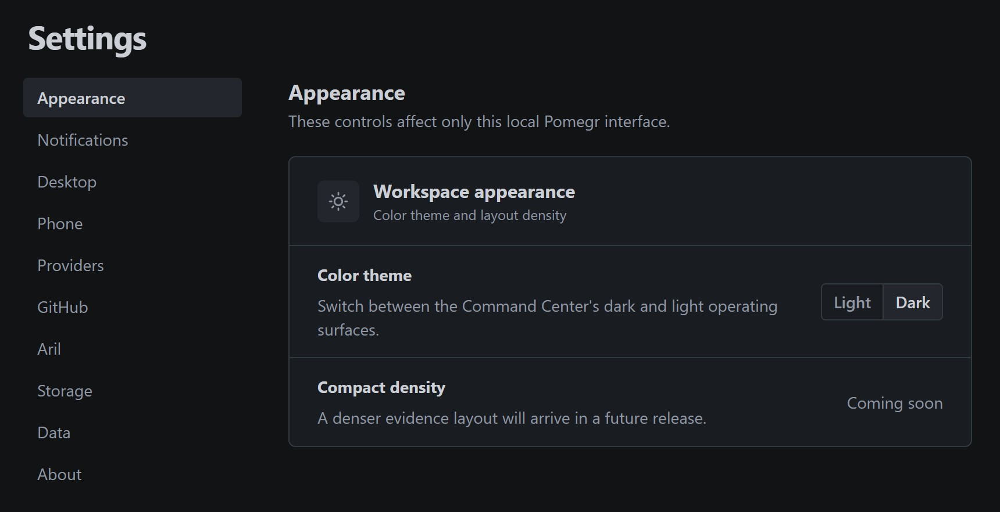
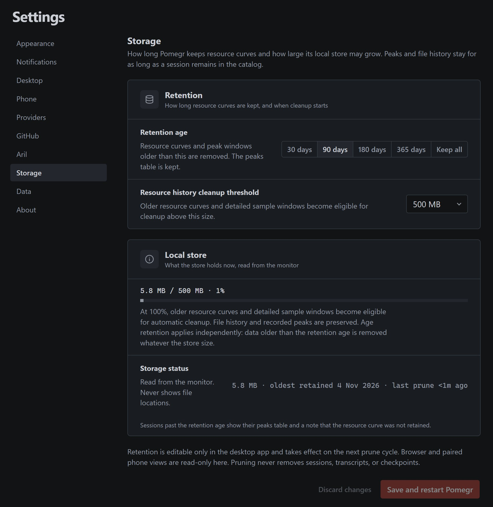

# Settings

**Settings** changes how Pomegr looks, which local folders it observes, and how
long it keeps its own resource history. It never controls your coding agents;
Pomegr stays read-only. Some sections change only in the desktop app, and a browser
shows them read-only.

## Find a setting

Select **Settings** in the sidebar. **Restore defaults** resets only the **Data
display** preference.

*The Pomegr 0.10.0 desktop app on the project's own development machine,
captured on 2026-11-03.*

| Section | What it does | Available in |
| --- | --- | --- |
| **Appearance** | Switches the **Color theme** between **Light** and **Dark**. **Compact density** is marked **Coming soon**. | Desktop app and browser |
| **Notifications** | Turns **Desktop notifications** on or off, chooses **Needs input**, **Provider updates**, and **Model news**, and pauses delivery with **Quiet for one hour**. The two news choices start off. **Completed session updates** reads **Coming soon**. | Change in the desktop app; a browser reads **Desktop managed** |
| **Desktop** | Chooses what happens **When closing the window**: **Ask**, **Keep in tray**, or **Quit**. | Desktop app only |
| **Phone** | Shares the dashboard, read-only, with a paired phone on your private network. See [Phone access](phone-access.md). | Desktop app only |
| **Providers** | Chooses the Claude Code and Codex folders Pomegr observes. | Change in the desktop app; view in a browser |
| **GitHub** | Shows whether the GitHub CLI is installed and signed in, and what your account can do in each repository. See [GitHub issues](github-issues.md#connect-github). | Desktop app only; a browser reads **Desktop managed** |
| **Aril** | Turns Aril on or off, and holds Aril's memory, conversation space, and effort routing. See [Agent chat](agent-chat.md#turn-aril-on-or-off). | Desktop app; a paired phone only as that page describes |
| **Storage** | Limits how long and how large Pomegr's resource history grows. | Change in the desktop app; view in a browser |
| **Data** | Shows or hides the **API list-rate estimate** under **Data display**. | Desktop app and browser |
| **About** | Shows the version, updates, privacy notes, how to report a problem, and the license and legal documents, which open inside Pomegr. | Desktop app and browser; update controls only in the desktop app |

A browser on the same computer, or a [paired phone](phone-access.md), sees
**Providers** and **Storage** without the controls that change them. Alerts and
the other desktop controls exist only in the desktop app.

## Choose provider folders

Use **Providers** when your coding tool keeps its history outside the default
locations. For the steps, see
[If you use a different profile](../get-started/first-session.md#if-you-use-a-different-profile).
In the desktop app, each row shows **Default folder**, **Launch environment**, or
**Custom folder**, and whether the folder is available; an available folder may
hold no sessions.
Select **Use default** to remove a saved choice or **Discard changes** to undo
pending ones. Nothing changes until **Save and restart Pomegr**. Pomegr does not
move files or change a running coding tool's account. A browser shows the
effective folders as read-only text, or **Path unavailable**.

## Manage storage

1. In the desktop app, open **Settings → Storage**.
2. Choose a **Retention age**: 30, 90, 180, or 365 days, or **Keep all**.
3. Choose a **Resource history cleanup threshold**: 250 MB, 500 MB, 1 GB, or
   2 GB.
4. Select **Save and restart Pomegr** and review the native confirmation. Pomegr
   applies the values at its next start and pruning cycle. Unset values use the
   defaults, 90 days and 500 MB.

*The same desktop app, in a new profile with a small store. The buttons are dimmed
because nothing has changed yet, and the app writes dates in UTC, so the oldest
retained day reads 4 Nov. A browser shows the same section read-only.*

Pruning only trims Pomegr's own resource curves and detailed sample windows. It
never removes sessions, transcripts, checkpoints, file history, or recorded
peaks. A session older than the retention age keeps its peaks table and shows a
note that its resource curve was not retained. **Storage status** reports the
size, the oldest retained day, and the last prune.

## Show or hide the estimate

**API list-rate estimate** shows the provider-reported estimate on a session's
Overview **Cost** panel. It is not a bill or subscription spend, and it appears
only when Claude Code local usage is enabled. See
[Signals and estimates](../concepts/signals-and-estimates.md). The preference
applies to every live and recorded session and is saved in that browser or in the
desktop app.

## Use the desktop controls

The desktop app puts an icon in the Windows notification area. Its menu offers
**Open Pomegr**, **Pause live refresh** (then **Resume live refresh**),
**Launch at login**, **About Pomegr**, and **Quit Pomegr**.

- **Pause live refresh** pauses dashboard polling only. It does not touch your
  coding agents, and it is not saved.
- **Launch at login** is opt-in and works only in the installed app.
- The first time you close the window, Pomegr asks whether to keep running in the
  tray or quit, with **Remember my choice**. Closing to the tray keeps observing;
  **Quit Pomegr** stops it. Change a remembered choice under
  **Settings → Desktop**.
- When a live session starts needing your input, Pomegr shows a Windows
  notification titled with the session's title that says "Needs input. This live
  session is waiting for your action." A session without a title gets the title
  "Pomegr" and the text "A coding-agent session needs input." It never includes the
  question, a command, or any conversation content. Selecting it brings the
  Pomegr window forward and opens that session. Pomegr then brings the window
  where the session runs to the front, but only when it can tell which window
  that is: a console window, a single-window app, or the one Windows Terminal
  window whose title holds one of the session's titles. When it can't tell, it brings
  no other window forward. **Desktop notifications** and
  **Needs input** are on by default. Turn either off, or pause delivery with
  **Quiet for one hour**, under **Settings → Notifications**;
  the pause is not saved and ends when Pomegr restarts. Windows notification
  settings or Focus Assist can also silence them.
  The initial observation establishes a baseline without replaying old alerts.
  Alerts observed while disabled or quiet are not queued for later. A durable
  claim prevents normal restart replay, but a crash before Windows displays the
  toast can suppress it; the occurrence remains in the notification tray.
- **Provider updates** and **Model news** are off by default. Turn either on
  under **Settings → Notifications** to allow supported news to use Windows
  notifications.
  Release news covers published Claude Code latest releases and Codex CLI
  releases. It does not report Codex desktop or IDE releases, or claim that a
  CLI installation can update. A current Pomegr reporting-plugin setup can
  show an update when its installed version is behind the official release.
  Claude Code release news shows the first lines of its release notes as plain
  text. Codex CLI release news shows fixed text, because its source has no notes.
  **What's new** opens the release page on GitHub in your browser. Opening release
  news otherwise only navigates inside Pomegr; it never installs software.
  Model news distinguishes an official OpenAI announcement from a model
  **listed in your client**. Codex can return a bundled or cached catalog, so
  neither means your account has access. Only narrowly recognized OpenAI
  introduction or retirement headlines are covered; missing catalog rows never
  mean retirement. Claude model news and account-access checks are unavailable.
  The notification tray can still show an occurrence while native
  delivery is disabled or quiet. Opening the tray marks everything it shows as
  read and clears the unread indicator on the bell. Entries that were unread
  keep a **New** mark until you close the tray. Reading does not end an active
  Needs input condition. Read markers stay in this browser's local storage for
  up to 30 days. The desktop app's browser read markers can reset on restart, and
  they do not control Windows delivery.
- **Aril follow-ups** are on by default. Follow-ups that arrive in a row and
  need nothing from you are one entry in the tray, with the earlier lines folded
  under it. A follow-up that needs you is its own entry and its own Windows
  notification. A routine follow-up never opens a Windows notification by
  itself. When five or more wait and the oldest is more than an hour old,
  Windows shows one summary, at most once an hour, and not while the Pomegr
  window is in front. Pomegr counts a follow-up as waiting until the window was
  last in front after it arrived.
- Codex asynchronous questions can show **Needs input** while the agent continues
  working. An accepted question submission is not an answer. Codex's recorded
  messages do not reliably identify which asynchronous question a later reply
  answers, so a later user message changes that question's status to **Unknown**.
  A recorded turn ending or a new turn ends its outstanding question scope. A
  resolved tray item means the Needs input condition ended; it does not confirm
  that you answered the question. Question text and answers are never included.
- **Settings → About** shows the installed version, **Check for updates**, and
  **Restart and install**. A portable build never checks for updates. See
  [Keep Pomegr up to date](../get-started/install.md#keep-pomegr-up-to-date).
